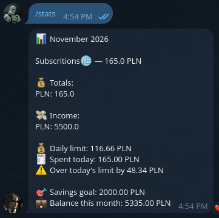
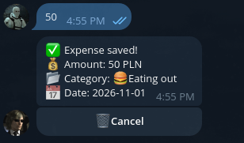
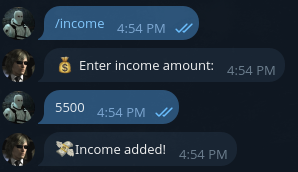
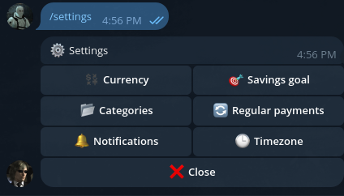

# Kopo

[](https://github.com/SargeraSSS/kopo/actions/workflows/tests.yml)

A personal finance tracker you control entirely through Telegram — log expenses and income, track spending by category, and get a daily spending limit calculated automatically from your income, savings goal, and what you've already spent.

**Try it:** [@fintrack_multitoolbot](https://t.me/fintrack_multitoolbot)






## Architecture

```
Telegram Bot  →  Django REST API  →  PostgreSQL, Redis
```

## Features

- Log expenses and income via chat, cancel a saved expense with one tap
- Monthly stats: spending by category, income, smart daily limit
- Savings goal that feeds into the daily limit
- Custom categories
- Recurring payments, auto-logged monthly
- Daily reminders in your own timezone (toggleable)
- Multi-currency support (PLN, UAH, EUR, USD)
- `/help` guide built into the bot

## Engineering highlights

- **Safe to repeat:** the recurring payments job runs hourly and locks the rows it charges, so a retry or a restart never logs a payment twice.
- **Per-user timezones:** a new day starts at a different moment for each user, which is why dates, reminders and recurring payments follow the user's own timezone.
- **Small attack surface:** the production setup publishes no ports. The bot polls Telegram and reaches the API over the internal Docker network, and the app containers run as a non-root user.
- **Rate limiting:** request counters live in Redis, so the limits are shared between gunicorn workers.
- **Tested:** 200+ tests run on every push through GitHub Actions.

## Tech stack

- **Backend:** Django, Django REST Framework, PostgreSQL, Redis (rate limiting), Token auth
- **Bot:** python-telegram-bot, httpx, APScheduler (background jobs)
- **Testing:** pytest, pytest-django
- **Infra:** Docker, Docker Compose, GitHub Actions (CI), deployed on a Hetzner VPS

## Quick start

```bash
git clone https://github.com/SargeraSSS/kopo.git
cd kopo
cp .env.example .env    # fill in the secrets
```

The first start also creates the bot's staff user and its token, see [Setup & deployment](docs/deployment.md).

## Status

Fully functional and deployed — running 24/7 on a VPS via Docker.

## Documentation

- [Architecture](docs/architecture.md) — components, data model, auth, scheduled jobs
- [API reference](docs/api.md) — endpoints and examples
- [Setup & deployment](docs/deployment.md) — configuration, Docker, tests, production checklist

## License

[MIT](LICENSE)
